# SmartAccess — Explicação completa do projeto

Guia de estudo para a defesa. Explica cada parte do sistema, como as partes falam umas com as outras
e porque foram tomadas as decisões principais. Os diagramas estão em Mermaid (aparecem desenhados no
GitHub e na pré-visualização de Markdown do VS Code).

---

## Índice

1. [O que é o SmartAccess](#1-o-que-é-o-smartaccess)
2. [Arquitetura geral](#2-arquitetura-geral)
3. [Arduino (a porta)](#3-arduino-a-porta)
4. [API REST (o cérebro)](#4-api-rest-o-cérebro)
5. [Base de dados (a memória)](#5-base-de-dados-a-memória)
6. [App Android (o painel do administrador)](#6-app-android-o-painel-do-administrador)
7. [Fluxos completos passo a passo](#7-fluxos-completos-passo-a-passo)
8. [Segurança](#8-segurança)
9. [Alertas](#9-alertas)
10. [Limitações e melhorias futuras](#10-limitações-e-melhorias-futuras)
11. [Resumo para memorizar](#11-resumo-para-memorizar)

---

## 1. O que é o SmartAccess

Um sistema de **controlo de acesso a salas** (sala técnica / sala de aula):

- Cada porta tem um **Arduino** com leitor de cartões **RFID**, dois **sensores ultrassónicos** que contam
  quem entra e sai, um **LCD**, **LEDs** e um **buzzer**.
- Quando alguém passa um cartão, o Arduino pergunta à **API** (na cloud, Vercel) se pode abrir.
- A API consulta a **base de dados PostgreSQL** (cartões, horários, perfis) e decide.
- O **administrador** gere tudo numa **app Android**: aprova cartões e portas, define horários,
  vê registos, alertas e abre portas à distância.

> **Ideia central:** o Arduino **não decide nada** — lê sensores e executa ordens.
> **Quem decide é sempre a API**, com base nos dados da BD. Uma só fonte de verdade.

---

## 2. Arquitetura geral

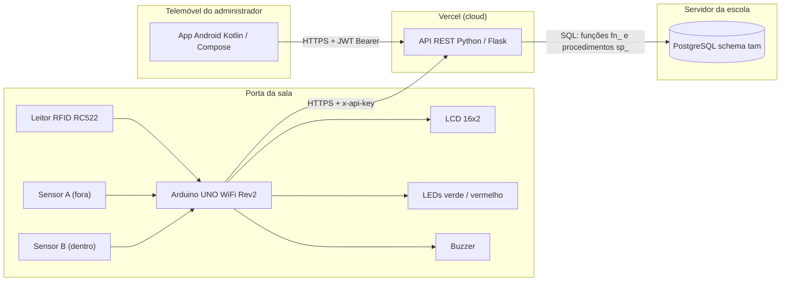

### Responsabilidade de cada parte

| Parte | Tecnologia | Responsabilidade |
|---|---|---|
| Arduino | C++ (Arduino IDE) | Ler cartões e sensores, mostrar estado, executar o que a API manda |
| API | Python + Flask no Vercel | Autenticar, aplicar as regras de negócio, criar alertas |
| Base de dados | PostgreSQL | Guardar dados e garantir integridade (restrições, trigger, índices) |
| App | Kotlin + Jetpack Compose | Interface do administrador |

### Porque é que o Arduino não fala diretamente com a BD?

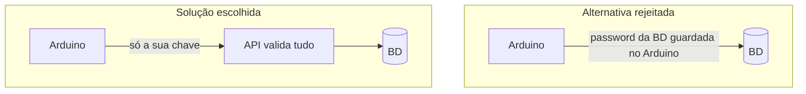

- O Arduino é um aparelho físico, pode ser roubado: **não pode ter a password da BD**.
- As regras ficam num só sítio (API): mudar um horário na app tem efeito imediato em todas as portas.

---

## 3. Arduino (a porta)

Ficheiro: [`arduino/arduino.ino`](../arduino/arduino.ino)

### 3.1 Hardware e pinos

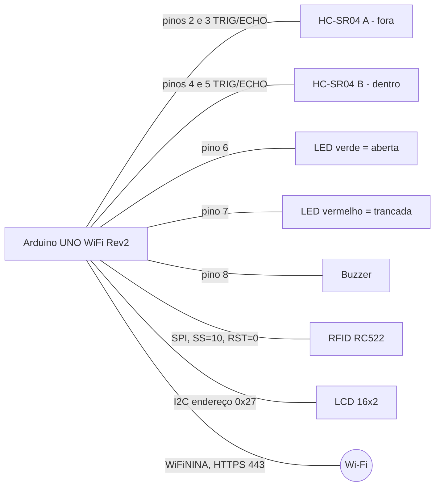

> **Porque não há servo?** O servo consumia demasiada corrente e fazia cair o Wi-Fi.
> O estado da porta é mostrado pelos LEDs. Numa instalação real usava-se uma fechadura com relé e
> alimentação própria.

### 3.2 Arranque (`setup`)

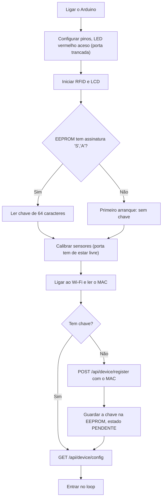

**EEPROM** (memória que não se apaga ao desligar):

| Endereço | Conteúdo |
|---|---|
| 0–1 | Assinatura `'S'`, `'A'` → "há dados válidos" |
| 2–65 | Chave da API (64 caracteres hexadecimais) |

### 3.3 Estados do dispositivo

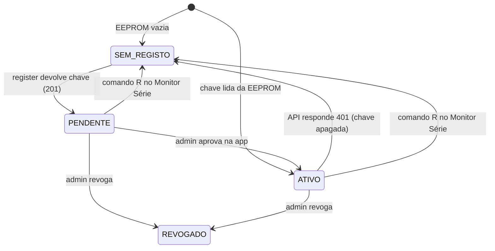

- **PENDENTE / REVOGADO:** os cartões são ignorados; o LCD mostra "Aguarda aprovac." / "Porta revogada".
- **401:** a chave deixou de existir na BD (ex.: porta apagada ou `reset.sql`) → apaga-a e regista-se de novo.

### 3.4 O ciclo principal (`loop`)

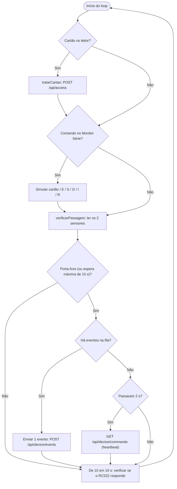

> **Porque é que só fala com a API com a porta livre?**
> Um pedido HTTPS demora 0,3–1 s e **bloqueia o loop**: durante esse tempo os sensores não são lidos
> e uma passagem perdia-se. Por isso conta-se logo e envia-se depois.

### 3.5 Tratar um cartão

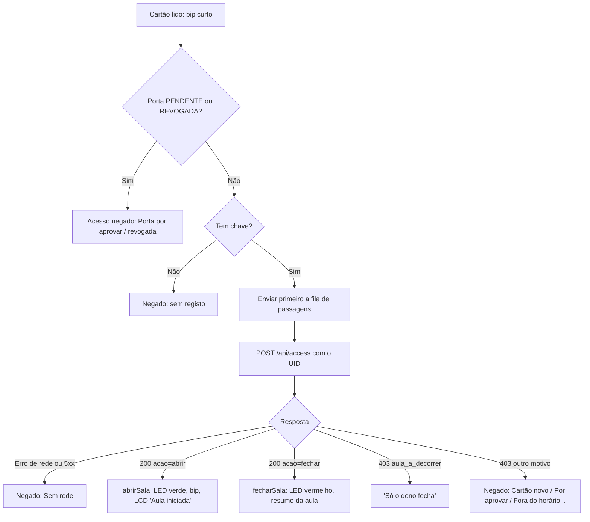

**Sem rede nada abre** — é uma decisão de segurança (*fail-secure*). Existia um modo offline que foi
retirado de propósito.

### 3.6 Contagem de pessoas com 2 sensores

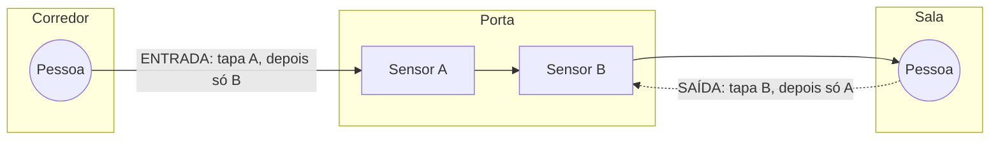

A ideia: segue-se **o lado onde a pessoa está**. Quando ela fica só no sensor do lado oposto ao que
tapou primeiro, atravessou a porta.

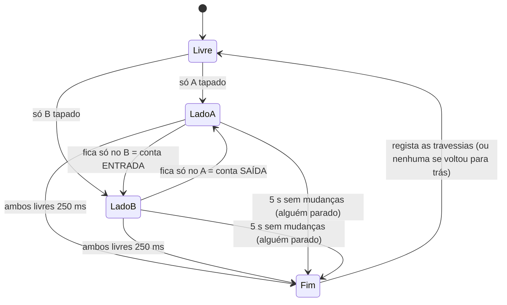

| Movimento | Resultado |
|---|---|
| A → B | 1 entrada |
| B → A | 1 saída |
| A → B → A (entra e volta logo a sair) | 1 entrada + 1 saída |
| A → volta para trás | não conta |

**Como se combate o ruído dos sensores:**

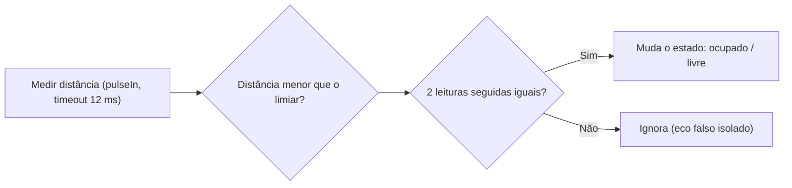

- **Calibração no arranque:** 10 medições com a porta livre → limiar = referência − 45 cm
  (sem eco, fica 100 cm).
- **Filtro:** são precisas 2 leituras seguidas para mudar de estado.
- **10 ms entre sensores:** o eco de um não chega ao outro.
- **Porta trancada → sensores ignorados:** alguém a passar no corredor não conta.

### 3.7 A fila de eventos pendentes

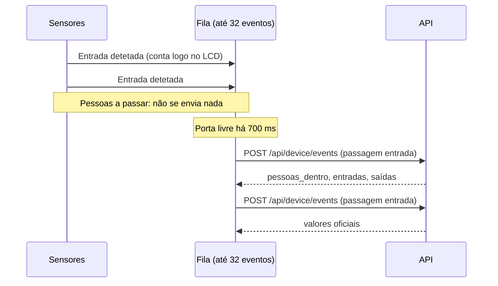

- A **API tem a contagem oficial**; o Arduino ajusta a sua com a resposta + o que ainda está na fila.
- Envia **um evento de cada vez** para voltar a ler os sensores entre pedidos.
- Com movimento contínuo, envia na mesma ao fim de **15 s**.

### 3.8 Comunicação com a API

- **HTTPS obrigatório** (o Vercel só aceita HTTPS) com `WiFiSSLClient`.
- **Keep-alive:** a ligação fica aberta; só o primeiro pedido paga o handshake TLS (~1–2 s).
  Se o servidor fechou a ligação, tenta uma segunda vez.
- **JSON sem biblioteca:** `lerCampoTexto` / `lerCampoNumero` procuram `"campo":` no texto da resposta
  (poupa RAM). Por isso a API envia JSON compacto, sem espaços.

### 3.9 Feedback ao utilizador

| Situação | LED | Buzzer | LCD |
|---|---|---|---|
| Cartão lido | — | bip curto agudo | "A verificar..." |
| Aula iniciada | verde | bip 1000 Hz | "Aula iniciada / nome" |
| Sala fechada | vermelho | bip 800 Hz longo | "Sala fechada" |
| Acesso negado | vermelho a piscar 3× | 3 bips graves | "Acesso negado / motivo" |
| Entrada / saída | — | agudo / grave | "Entrou 1 pessoa / Dentro: N" |
| Entrada sem aula | — | 3 bips longos | "ALERTA" |

### 3.10 Comandos de teste no Monitor Série (9600 baud)

| Comando | Efeito |
|---|---|
| `8DF36E69` (um UID) | Simula a passagem desse cartão |
| `E` / `S` | Simula uma entrada / saída |
| `D` | Mostra as distâncias dos sensores em tempo real |
| `I` | Estado da porta e da aula |
| `R` | Apaga a chave e regista-se de novo |
| `?` | Ajuda |

---

## 4. API REST (o cérebro)

Ficheiro: [`api/index.py`](../api/index.py) — Python + Flask, alojada no **Vercel** com deploy
automático a cada `push` para a `main`.

### 4.1 Mapa das rotas

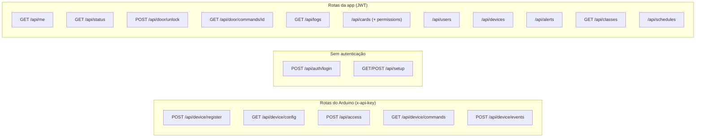

| Método | Rota | Para quê |
|---|---|---|
| POST | `/api/device/register` | Arduino novo envia o MAC e recebe a chave |
| GET | `/api/device/config` | Nome da porta, intervalo, pessoas dentro, aula a decorrer |
| POST | `/api/access` | **Decidir** se um cartão abre, fecha ou é negado |
| GET | `/api/device/commands` | Comandos de abertura remota (serve de heartbeat) |
| POST | `/api/device/events` | Passagens e confirmação de comandos executados |
| POST | `/api/auth/login` | Login do admin → JWT |
| GET/POST | `/api/setup` | Saber se falta o admin / criar o primeiro admin |
| GET | `/api/status` | Estado das portas para o painel |
| POST | `/api/door/unlock` | Pedir abertura remota |
| GET | `/api/logs` | Registos de acesso com filtros |
| CRUD | `/api/cards`, `/api/users`, `/api/devices` | Gestão |
| GET/PATCH | `/api/alerts` | Ver / resolver alertas |
| GET | `/api/classes` | Histórico das aulas |
| GET/PUT | `/api/schedules/{perfil}` | Horários por perfil |

### 4.2 Ciclo de vida de um pedido

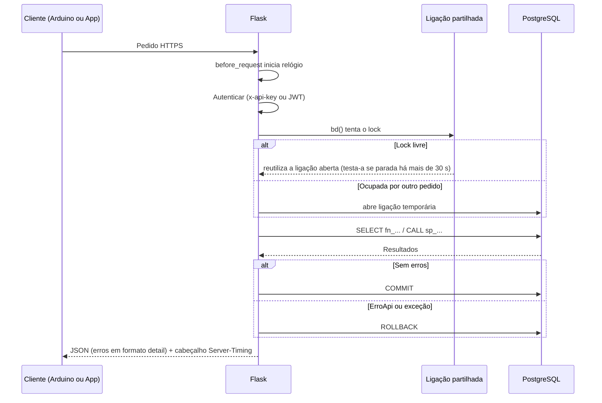

- **Ligação partilhada:** abrir uma ligação nova (TCP + TLS + autenticação) custava ~1 s por pedido.
- **Cada pedido = uma transação:** ou fica tudo gravado, ou nada.
- **Erros uniformes:** `{"detail": "mensagem"}` com o código HTTP certo (400, 401, 403, 404, 409, 422).

### 4.3 A regra principal: `POST /api/access`

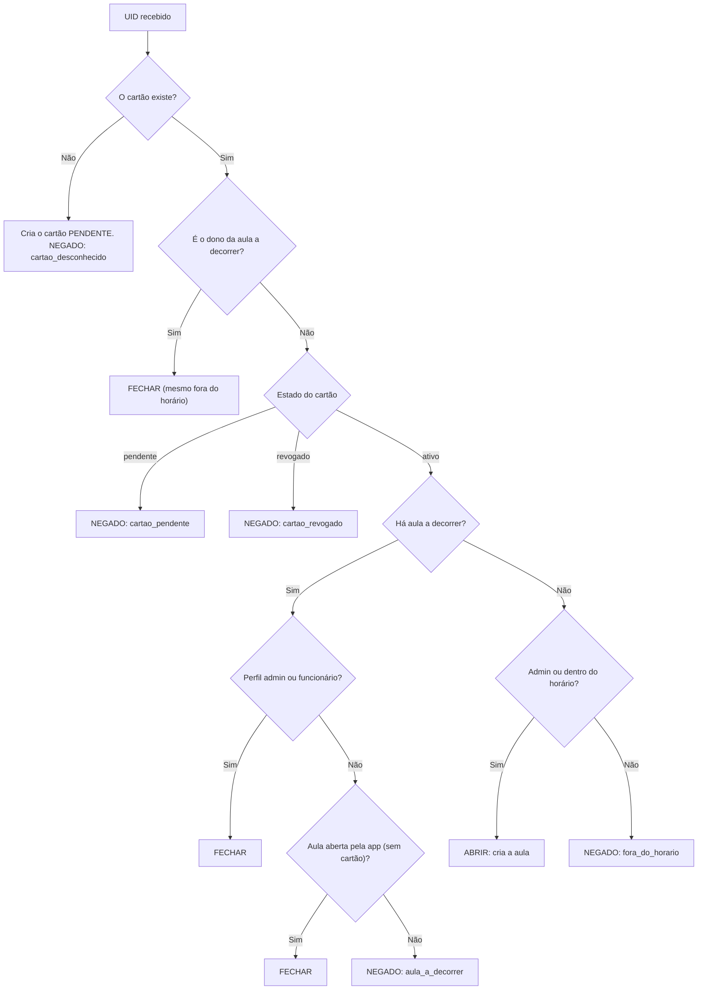

Depois da decisão, **sempre**:
1. Grava um registo em `registos_acesso` (concedido / negado, com motivo).
2. Se abrir → cria a aula e marca a porta aberta.
3. Se fechar → fecha a aula, tranca, e se ainda há pessoas contadas dentro cria o alerta
   `saida_nao_detetada` e repõe a contagem a 0.
4. Se negar → verifica se já há 3 negados seguidos (alerta `tentativas_negadas`).

### 4.4 Perfis e permissões

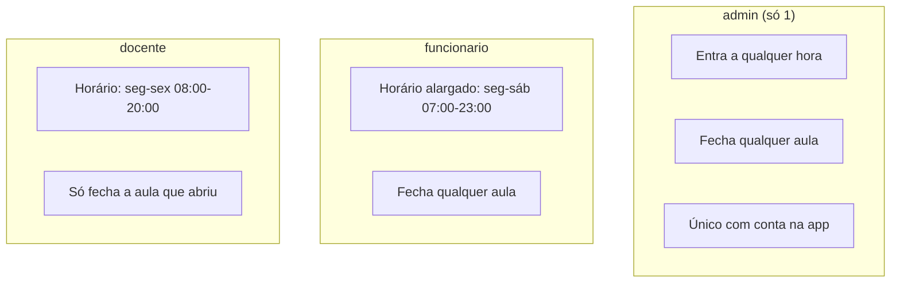

**Como se decide o horário de um cartão:**

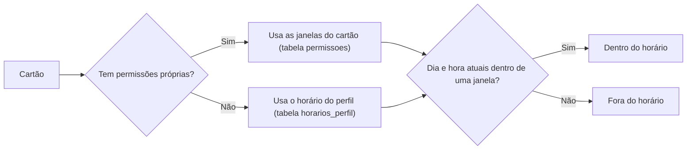

O fuso horário usado é `Europe/Lisbon` (variável `FUSO_HORARIO`).

### 4.5 Proteções na API

| Problema | Proteção |
|---|---|
| SQL injection | Consultas sempre com parâmetros (`%s`), via funções e procedimentos |
| Dados inválidos | `ler_inteiro`, `ler_uid`, `ler_hora`, `ler_janelas`... → 422 |
| Dois cartões a abrir ao mesmo tempo | Índice único na BD → `UniqueViolation` → 409 |
| Comando remoto antigo | Expira ao fim de 1 minuto |
| Admin despromovido com token válido | Em cada pedido confirma-se que ainda é admin |
| Ficar sem administrador | Não pode mudar o próprio perfil; o admin não pode ser removido |

---

## 5. Base de dados (a memória)

Pasta: [`database/`](../database/) — PostgreSQL no servidor da escola, tudo no schema `tam`.

### 5.1 Modelo entidade-relação

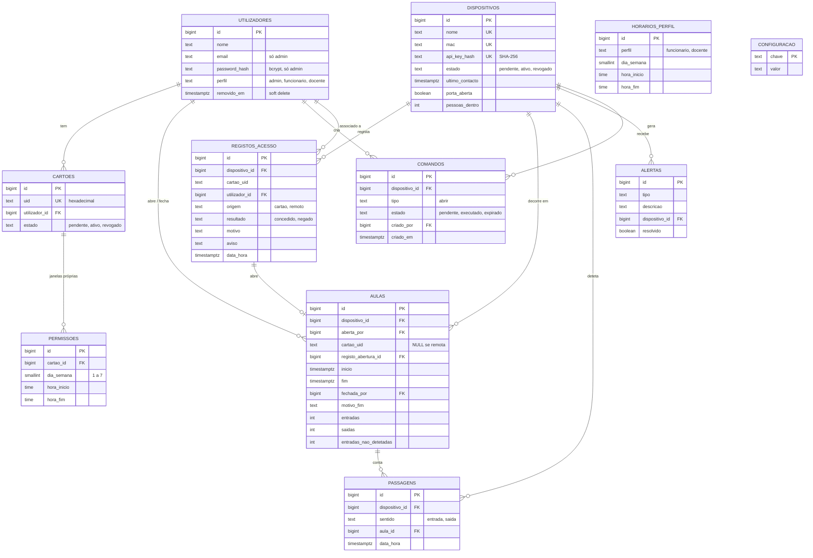

### 5.2 Estados dos cartões, das portas e dos comandos

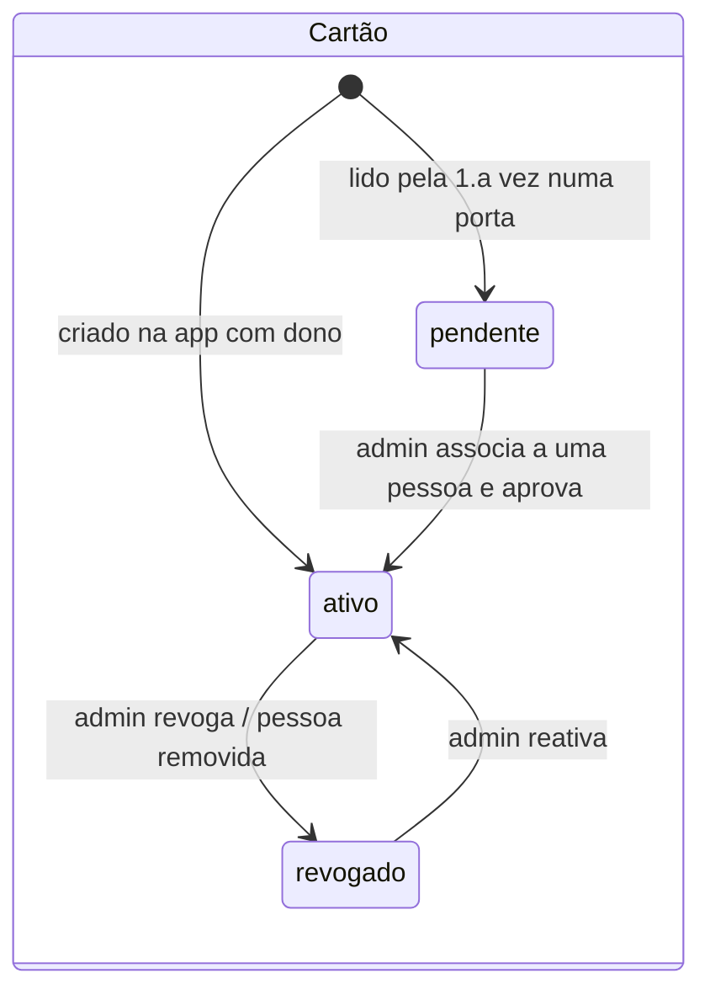

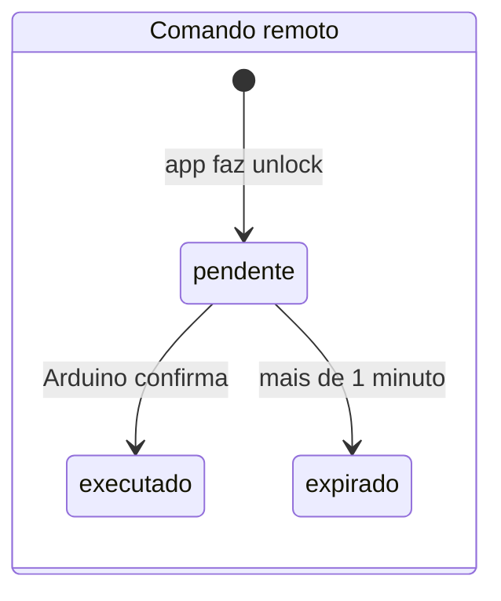

### 5.3 Integridade garantida pela própria BD

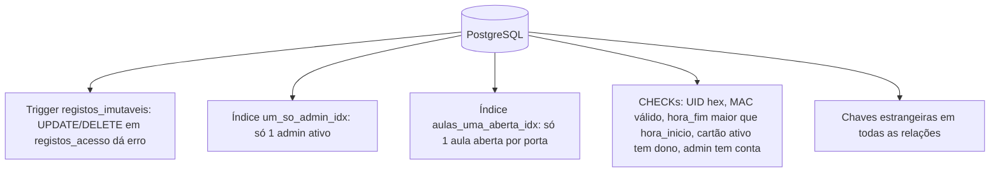

- **Registos imutáveis = auditoria.** Única exceção: apagar uma porta apaga o histórico dela
  (`sp_apagar_dispositivo` liga a variável `tam.apagar_porta` só durante essa transação).
- **Soft delete de pessoas:** remover preenche `removido_em` e revoga os cartões; o histórico
  continua a mostrar o nome.

### 5.4 Funções e procedimentos

A API **não escreve SQL solto**: chama funções e procedimentos guardados na BD.

```mermaid
flowchart LR
    API["API Python"] -- "SELECT * FROM fn_...()" --> FN["Funções fn_ (consultar / devolver linhas)"]
    API -- "CALL sp_...()" --> SP["Procedimentos sp_ (alterar dados)"]
    FN --> TAB[("Tabelas tam.*")]
    SP --> TAB
```

| Exemplos de funções (`fn_`) | Exemplos de procedimentos (`sp_`) |
|---|---|
| `fn_cartao_acesso(uid)` | `sp_inserir_aula(...)` |
| `fn_dentro_do_horario(cartao, perfil, dia, hora)` | `sp_fechar_aula(...)` |
| `fn_aula_aberta(dispositivo)` | `sp_abrir_porta` / `sp_fechar_porta` |
| `fn_contar_negados(dispositivo)` | `sp_inserir_alerta(...)` |
| `fn_registar_dispositivo(nome, mac, hash)` | `sp_expirar_comandos(...)` |
| `fn_estado_sistema(intervalo)` | `sp_remover_utilizador(...)` |

### 5.5 Scripts e ordem de execução

```mermaid
flowchart LR
    S1["1. schema.sql: tabelas, índices, trigger"] --> S2["2. functions.sql + procedures.sql"]
    S2 --> S3["3. seed.sql: horários por omissão"]
    S3 --> OK(["Pronto"])
    RST["reset.sql: apaga TODOS os dados"] -.-> OK
```

Todos podem ser executados várias vezes (`IF NOT EXISTS`, `CREATE OR REPLACE`, `ON CONFLICT DO NOTHING`).
O `reset.sql` usa `TRUNCATE`, que não passa pelo trigger (este só trava UPDATE/DELETE linha a linha).

---

## 6. App Android (o painel do administrador)

Pasta: [`android/`](../android/) — Kotlin, Jetpack Compose, arquitetura **MVVM**.

### 6.1 Arquitetura MVVM

```mermaid
flowchart LR
    subgraph View["View (ecrãs Compose)"]
        S1["PainelScreen"]
        S2["RegistosScreen"]
        S3["CartoesScreen ..."]
    end
    subgraph VM["ViewModel"]
        V1["PainelViewModel"]
        V2["RegistosViewModel"]
        V3["CartoesViewModel ..."]
    end
    subgraph Model["Model / dados"]
        API["SmartAccessApi (Retrofit + OkHttp + Gson)"]
        DS["SessaoStore (DataStore: token)"]
        MOD["Modelos.kt (classes de dados)"]
    end
    S1 -- "ações do utilizador" --> V1
    V1 -- "StateFlow (estado)" --> S1
    S2 <--> V2
    S3 <--> V3
    V1 --> API
    V2 --> API
    V3 --> API
    API -- "HTTPS + Bearer token" --> NET(("API REST"))
```

- **View:** só desenha o que o ViewModel diz.
- **ViewModel:** guarda o estado (`StateFlow`), chama a API em corrotinas, sobrevive a rotações do ecrã.
- **Model:** a interface Retrofit, as classes de dados e o armazenamento da sessão.

### 6.2 Sessão e primeiro arranque

```mermaid
stateDiagram-v2
    [*] --> ACarregar: abrir a app
    ACarregar --> Ativa: há token guardado no DataStore
    ACarregar --> SemSessao: não há token
    SemSessao --> CriarAdmin: GET /api/setup diz precisa_admin
    SemSessao --> Login: já existe admin
    CriarAdmin --> Ativa: POST /api/setup devolve token
    Login --> Ativa: POST /api/auth/login devolve token
    Ativa --> SemSessao: botão Sair ou API responde 401
```

- O **interceptor do OkHttp** junta `Authorization: Bearer <token>` a todos os pedidos.
- Qualquer **401** termina a sessão e volta ao login.

### 6.3 Navegação

```mermaid
flowchart TB
    APP["EcraPrincipal (barra inferior)"] --> P["Painel: estado das portas, abrir remotamente"]
    APP --> A["Aulas: histórico, duração, entradas e saídas"]
    APP --> R["Registos: filtros por data, pessoa, resultado"]
    APP --> G["Gestão"]
    APP --> AL["Alertas: ver e marcar como resolvido"]
    G --> G1["Portas: aprovar, renomear, revogar, apagar"]
    G --> G2["Cartões: aprovar, associar, revogar, horário próprio"]
    G --> G3["Pessoas: criar, editar, remover"]
    G --> G4["Horários: por perfil (docente, funcionário)"]
```

### 6.4 Abrir uma porta à distância (do lado da app)

```mermaid
flowchart TD
    B["Admin carrega em Abrir"] --> U["POST /api/door/unlock"]
    U --> M["Snackbar: Pedido enviado"]
    M --> W["Esperar 1 s"]
    W --> G["GET /api/door/commands/id"]
    G --> E{"estado"}
    E -- "pendente e menos de 60 tentativas" --> W
    E -- "executado" --> OK["Porta aberta"]
    E -- "expirado" --> EX["O dispositivo não respondeu a tempo"]
```

---

## 7. Fluxos completos passo a passo

### 7.1 Instalar uma porta nova

```mermaid
sequenceDiagram
    actor Admin
    participant ARD as Arduino
    participant API
    participant BD as PostgreSQL
    participant APP as App
    ARD->>API: POST /api/device/register (mac)
    API->>API: gera chave aleatória (token_hex 32)
    API->>BD: guarda SHA-256 da chave, estado pendente
    API->>BD: alerta dispositivo_novo
    API-->>ARD: 201 api_key, nome PORTA-XXXXXX, pendente
    ARD->>ARD: guarda chave na EEPROM
    loop a cada 10 s
        ARD->>API: GET /api/device/config
        API-->>ARD: 403 a aguardar aprovação
    end
    Admin->>APP: Gestão, Portas, Aprovar com nome Sala 1.04
    APP->>API: PATCH /api/devices/id (ativo, nome)
    API->>BD: estado ativo
    ARD->>API: GET /api/device/config
    API-->>ARD: 200 nome Sala 1.04, intervalo 2 s
    ARD->>ARD: LCD mostra Sala 1.04 / Passe o cartão
```

### 7.2 Registar um cartão novo

```mermaid
sequenceDiagram
    actor Pessoa
    actor Admin
    participant ARD as Arduino
    participant API
    participant APP as App
    Pessoa->>ARD: passa cartão desconhecido
    ARD->>API: POST /api/access (uid)
    API->>API: cria cartão pendente
    API-->>ARD: 403 cartao_desconhecido
    ARD->>Pessoa: Acesso negado / Cartão novo
    Admin->>APP: Gestão, Cartões, cartão pendente
    APP->>API: PATCH /api/cards/id (ativo, utilizador_id)
    API-->>APP: cartão ativo
    Pessoa->>ARD: passa o cartão outra vez
    ARD->>API: POST /api/access
    API-->>ARD: 200 acao abrir
```

### 7.3 Uma aula completa

```mermaid
sequenceDiagram
    actor Docente
    actor Alunos
    participant ARD as Arduino
    participant API
    participant BD as PostgreSQL
    Docente->>ARD: passa o cartão
    ARD->>API: POST /api/access
    API->>BD: cartão ativo e dentro do horário?
    API->>BD: registo concedido + nova aula + porta aberta
    API-->>ARD: 200 abrir
    ARD->>ARD: LED verde, Aula iniciada
    Alunos->>ARD: entram (A para B)
    ARD->>ARD: conta e guarda na fila
    ARD->>API: POST /api/device/events (passagem entrada) quando a porta fica livre
    API->>BD: passagem + pessoas_dentro + entradas da aula
    Alunos->>ARD: saem (B para A)
    ARD->>API: POST /api/device/events (passagem saida)
    Docente->>ARD: passa o cartão (é o dono)
    ARD->>API: POST /api/access
    API->>BD: fecha aula e porta
    alt ainda há pessoas contadas dentro
        API->>BD: alerta saida_nao_detetada, contagem a 0
    end
    API-->>ARD: 200 fechar + resumo (duração, entradas, saídas)
    ARD->>ARD: LED vermelho, Sala fechada
```

### 7.4 Abertura remota

```mermaid
sequenceDiagram
    actor Admin
    participant APP as App
    participant API
    participant ARD as Arduino
    Admin->>APP: Abrir Sala 1.04
    APP->>API: POST /api/door/unlock
    API-->>APP: 202 comando_id
    loop a cada 2 s
        ARD->>API: GET /api/device/commands
        API->>API: expira comandos com mais de 1 min
        API-->>ARD: comandos (id, abrir)
    end
    ARD->>API: POST /api/device/events (comando_executado)
    API->>API: registo remoto + aula sem cartão
    API-->>ARD: dono = admin
    ARD->>ARD: LED verde
    loop a cada 1 s
        APP->>API: GET /api/door/commands/id
        API-->>APP: executado
    end
    APP->>Admin: Porta aberta
```

> Uma aula aberta pela app (sem cartão) pode ser fechada **por qualquer cartão ativo**, incluindo um
> docente — senão ninguém a conseguiria fechar sem a app.

### 7.5 Porquê polling e não "push"?

```mermaid
flowchart LR
    API["API no Vercel (serverless)"] -. "não consegue: o Arduino não tem IP público e o Vercel não mantém ligações abertas" .-> ARD["Arduino"]
    ARD -- "pergunta a cada 2 s: há comandos?" --> API
```

Custo: até ~2 s de atraso e muitos pedidos. Melhoria possível: MQTT num servidor próprio.

---

## 8. Segurança

```mermaid
flowchart TB
    subgraph ArdAuth["Autenticação do Arduino"]
        K1["Chave aleatória de 256 bits por porta"] --> K2["Enviada no cabeçalho x-api-key"]
        K2 --> K3["BD guarda só o SHA-256"]
        K3 --> K4["Porta nova só funciona depois de aprovada"]
    end
    subgraph AppAuth["Autenticação da app"]
        J1["Email + password"] --> J2["bcrypt com salt"]
        J2 --> J3["JWT HS256 válido 12 h"]
        J3 --> J4["Cada pedido confirma que ainda é admin"]
    end
    subgraph Transp["Transporte e dados"]
        T1["HTTPS em tudo (HTTP só no debug da app)"]
        T2["Segredos fora do Git: .env, arduino_secrets.h, variáveis do Vercel"]
        T3["Consultas parametrizadas: sem SQL injection"]
        T4["Registos de acesso imutáveis"]
    end
```

| Pergunta | Resposta curta |
|---|---|
| Porquê bcrypt nas passwords e SHA-256 nas chaves? | Passwords humanas são fracas → bcrypt (lento + salt). A chave tem 256 bits aleatórios → impossível adivinhar, um hash rápido chega. |
| E se roubarem o Arduino? | Só levam a chave dessa porta; o admin revoga-a ou apaga a porta. Não há password da BD lá dentro. |
| E se alguém registar um Arduino falso? | Fica pendente e gera alerta `dispositivo_novo`; sem aprovação não faz nada. |
| O `/api/setup` não tem autenticação? | Só funciona enquanto não houver admin; depois responde 409 (e o índice único garante-o na BD). |
| Os cartões podem ser clonados? | Sim — usamos só o UID (MIFARE Classic). Melhoria: cartões DESFire ou cartão + PIN. |

---

## 9. Alertas

```mermaid
flowchart LR
    E1["3 negados seguidos em 5 min"] --> A1["tentativas_negadas"]
    E2["Mais de 60 s sem contacto"] --> A2["dispositivo_offline"]
    E3["Entrada com a sala fechada"] --> A3["entrada_sem_acesso"]
    E4["Arduino novo registou-se"] --> A4["dispositivo_novo"]
    E5["Sala fechada com pessoas contadas dentro"] --> A5["saida_nao_detetada"]
    A1 --> APP["Separador Alertas na app"]
    A2 --> APP
    A3 --> APP
    A4 --> APP
    A5 --> APP
```

- Alertas "únicos" (ex.: offline) não se repetem enquanto houver um igual por resolver.
- **Offline sem tarefas agendadas:** o Vercel gratuito não tem *cron*, por isso a verificação é feita
  quando a app pede `/api/status` ou `/api/alerts`.

---

## 10. Limitações e melhorias futuras

| Limitação atual | Melhoria |
|---|---|
| Sem fechadura física (só LEDs) | Fechadura eletromagnética com relé e fonte própria |
| Duas pessoas lado a lado contam como uma | Mais sensores, sensor ToF ou câmara de contagem |
| Polling a cada 2 s | MQTT / WebSockets num servidor próprio |
| Cartões clonáveis (só UID) | Cartões com criptografia ou PIN |
| Token guardado sem cifra extra | Android Keystore / EncryptedDataStore |
| Sem notificações | Notificações push para alertas (FCM) |
| Testes manuais + Postman | Testes automáticos à API |
| Restos do antigo modo offline na API (`cartoes_offline`, evento `porta`) | Remover código morto |

---

## 11. Resumo para memorizar

```mermaid
mindmap
  root((SmartAccess))
    Arduino
      RFID RC522
      2 sensores HC-SR04
        A fora, B dentro
        A para B entrada
      LEDs, LCD, buzzer
      Regista-se pelo MAC
      Chave na EEPROM
      Polling 2 s heartbeat
      Sem rede não abre
    API Flask Vercel
      x-api-key Arduino
      JWT app
      POST access decide
      Alertas automáticos
      Comandos expiram 1 min
      Ligação BD partilhada
    PostgreSQL
      Schema tam
      Funções fn e procedimentos sp
      Registos imutáveis trigger
      1 admin, 1 aula por porta
      Soft delete
    App Android
      Kotlin Compose MVVM
      Retrofit OkHttp
      DataStore token
      Painel Aulas Registos Gestão Alertas
```

**Frases-chave para a defesa:**

1. "O Arduino só lê e executa; **a API decide sempre**."
2. "Cada porta **regista-se sozinha pelo MAC** e só funciona depois de o admin a aprovar."
3. "**Sem rede a porta não abre** — preferimos segurança a conveniência."
4. "A contagem segue **o lado onde a pessoa está**: de A para B é entrada, de B para A é saída."
5. "Os pedidos **bloqueiam os sensores**, por isso as passagens vão para uma fila e só se enviam com a porta livre."
6. "A **BD garante as regras críticas**: registos imutáveis, um só admin, uma só aula aberta por porta."
7. "A app segue **MVVM** e autentica-se com **JWT**; o Arduino com uma **chave por porta guardada como hash**."
